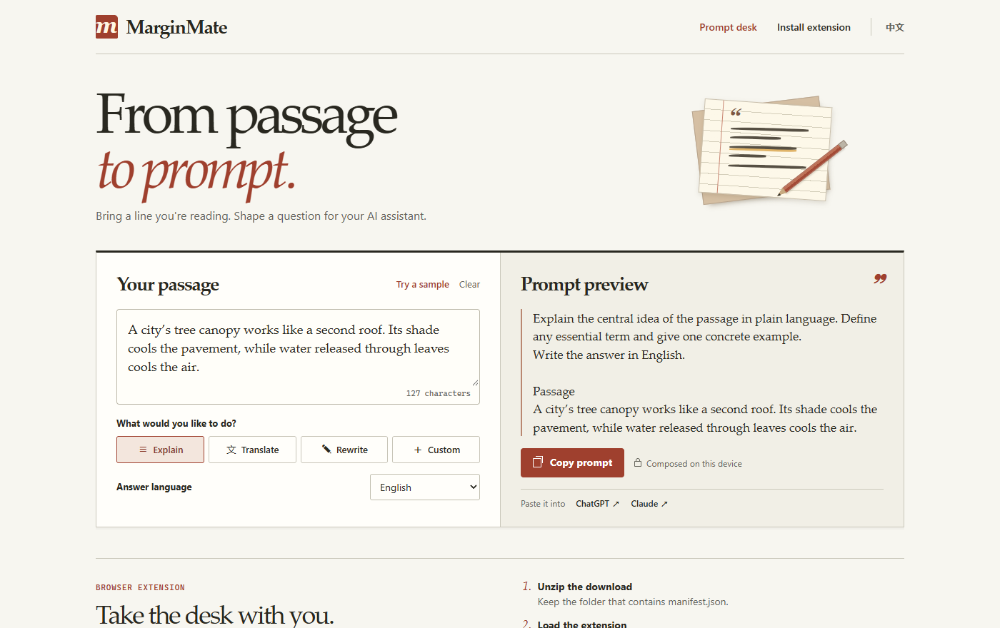

# MarginMate

Select a passage, choose **Explain**, **Translate**, **Rewrite** or your own instruction, then copy a complete prompt to your AI assistant. The browser extension opens the same desk beside the page and can send the prompt directly to a local model.

[Try the prompt desk](https://saimeeee.github.io/marginmate/) · [Download the extension ZIP](https://github.com/saimeeee/marginmate/releases/latest/download/marginmate.zip) · [中文说明](README.zh-CN.md)



## Try it first

1. Open the [web desk](https://saimeeee.github.io/marginmate/). Edit its sample passage.
2. Choose **Translate** and set **Answer language**. The preview updates as you type. **Custom** lets you write the instruction yourself.
3. Choose **Copy prompt**. Open ChatGPT, Claude or another assistant and paste it. The web desk composes text locally and works without an API key. Model generation is available in the installed extension through your own server.

## Install the extension

Use desktop Chrome 116+ or a current Chromium-based Microsoft Edge with sidebar support.

1. Download **marginmate.zip** from [Releases](https://github.com/saimeeee/marginmate/releases/latest/download/marginmate.zip). Extract it to a permanent location.
2. Open `chrome://extensions` or `edge://extensions`. Enable **Developer mode**, click **Load unpacked**, and select the extracted folder containing **manifest.json**. When working from a checkout, select the **extension/** directory.
3. On an ordinary HTTP(S) webpage, select text and right-click **Bring selection to MarginMate**. You can also pin and click the toolbar icon, or use **Alt+Shift+M**. Reassign conflicting shortcuts at `chrome://extensions/shortcuts` or `edge://extensions/shortcuts`.
4. Review the passage and copy the prompt. The toolbar reads the selected text in the main frame. For an embedded frame use the selection's context menu. On protected browser pages, paste the passage manually. If the browser rejects opening its side panel, MarginMate opens its desk in a tab.

## Local model setup

Install and run your own model server. In the extension, expand **Use a local model**, enter the origin and model name, and review the full **Destination** before clicking **Send to local model**. The first send asks for access to that loopback host. The browser may phrase this as access to all ports on the host.

| API format | Example server origin | Expected endpoint | Model name |
| --- | --- | --- | --- |
| Ollama | `http://127.0.0.1:11434` | `/api/chat` | An installed model from `ollama list` |
| OpenAI-compatible | `http://127.0.0.1:1234` | `/v1/chat/completions` | The identifier shown by your local server |

For Ollama, pull a model such as `ollama pull llama3.2`. Set **OLLAMA_ORIGINS** to **chrome-extension://YOUR_EXTENSION_ID**, using the ID shown in your browser's extension manager, and restart Ollama. This also applies to Chromium-based Edge. Use a locally installed model for offline inference. An OpenAI-compatible server such as LM Studio can use its own port and optional bearer token. The address field accepts `http://localhost` or `http://127.0.0.1` and an optional port. Supply the origin only.

HTTP 403 usually means the server needs the extension origin added. For 404, check the selected API format and model name. See [Ollama’s extension origin guidance](https://docs.ollama.com/faq#how-can-i-allow-additional-web-origins-to-access-ollama) and the [Ollama chat API](https://docs.ollama.com/api/chat).

## What stays on this device

- The web desk builds the prompt in page memory. Its outgoing assistant links contain no prompt or passage. Copying puts the prompt on your system clipboard.
- The extension has no startup access to websites. A toolbar gesture grants temporary access to read a selection. The context menu provides only the selected text. The extension does not request browsing history or collect surrounding paragraphs.
- The last imported passage for each browser window lives in browser-session memory until cleared, the window closes, or the browser restarts. Panel edits and answers stay in the panel. The UI language and the local model configuration are saved on this device. Tokens remain in the open panel only.
- Only **Send to local model** posts the preview to the displayed loopback endpoint. The model server's own logging and inference settings govern what it does with that request. Copying or following an assistant link does not send the passage to a model.

## Development

The product uses native browser APIs and has no runtime dependencies or build step. Use Node 22+ for tests and Python 3.8+ to build the ZIP.

```sh
npm test
node scripts/sync.mjs
python scripts/package.py
python -m http.server 8000 --directory docs
```

Edit shared UI files in **extension/**, then run the sync command before testing. The ZIP is written to **dist/marginmate.zip**, with **manifest.json** at its root. Open **http://localhost:8000** to try the site.

The CI browser test loads the unpacked extension in a temporary Chrome for Testing profile. To repeat it, install `playwright-core` as a development tool, set `BROWSER_EXECUTABLE` to the absolute path of a current Chrome for Testing binary, and run `npm run browser`. Its local model fixture implements the Ollama chat contract to test the request and response boundary.

[MIT license](LICENSE)
