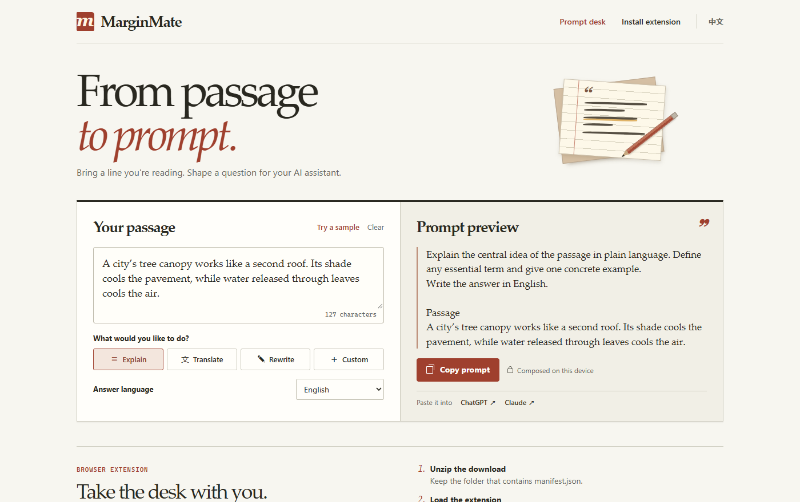

# MarginMate · 页边提问

读网页时，选中一段文字，选择解释、翻译、改写或自定义指令，便可复制完整提示词。安装扩展后，可在网页侧栏完成这些操作，也可将提示词发给自己运行的本地模型。

[在线使用](https://saimeeee.github.io/marginmate/) · [下载扩展 ZIP](https://github.com/saimeeee/marginmate/releases/latest/download/marginmate.zip) · [English](README.md)

## 直接使用网页版

1. 打开网页工作台。右上角可切换中文和英文。
2. 替换示例原文，选择任务和回答语言。“自定义”允许自己编写指令。
3. 点击“复制提示词”，打开常用 AI 助手并粘贴。网页版在当前设备生成提示词，无需注册或密钥。

## 安装桌面浏览器扩展

支持 Chrome 116 及以上版本，或支持侧栏的新版 Chromium 内核 Microsoft Edge。

1. 下载 **marginmate.zip**，解压到准备长期保留的文件夹。
2. 在地址栏输入 `chrome://extensions` 或 `edge://extensions`。启用“开发者模式”，点击“加载已解压的扩展程序”，选择直接包含 **manifest.json** 的文件夹。从源码安装时选择 **extension/**。
3. 在普通 HTTP(S) 网页中选中一段文字，右键选择“在 MarginMate 中处理选中文字”。英文浏览器菜单显示 **Bring selection to MarginMate**。也可固定工具栏图标后点击，或使用 **Alt+Shift+M**。快捷键冲突时可到扩展的快捷键设置页修改。
4. 核对侧栏中的原文和提示词后复制。工具栏读取主页面选区，内嵌页面请使用右键菜单。受浏览器保护的页面可手动粘贴。如果浏览器无法打开侧栏，扩展会在标签页打开工作台。

## 使用本地模型

在侧栏展开“调用本地模型”，输入本机服务地址与实际安装的模型名称。界面会显示完整发送目标。首次点击“发送给本地模型”时，浏览器会询问是否允许访问该本地主机。

| 服务 | 示例地址 | 调用路径 |
| --- | --- | --- |
| Ollama | `http://127.0.0.1:11434` | `/api/chat` |
| 兼容 OpenAI 的本地服务，例如 LM Studio | `http://127.0.0.1:1234` | `/v1/chat/completions` |

使用 Ollama 时，可先执行 `ollama pull llama3.2`，再用 `ollama list` 核实模型名称。将环境变量 **OLLAMA_ORIGINS** 设置为 **chrome-extension://你的扩展ID**，然后重启 Ollama。扩展 ID 在浏览器扩展管理页中可见。使用本机已下载的模型即可离线推理。地址栏只接受 HTTP 的 localhost 或 127.0.0.1 和可选端口，不填 API 路径。兼容 OpenAI 的服务可按需填写令牌。

出现 403 时检查服务器允许的扩展来源。出现 404 时核对 API 类型和模型名称。[Ollama 官方说明](https://docs.ollama.com/faq#how-can-i-allow-additional-web-origins-to-access-ollama)

## 数据保存

扩展由用户的工具栏或右键操作触发，只读取选区。最近导入的原文按窗口保存在浏览器会话内存中，点击“清空”、关闭窗口或重启浏览器即可清除。编辑中的内容和回答只留在面板内。界面语言及服务配置保存在本机，令牌仅存在于打开的面板。网页上的助手链接不会携带原文。只有点击“发送给本地模型”才会向显示的本地接口发送预览提示词，服务端的数据处理取决于其配置。

[开发与测试](README.md#development) · [MIT 许可证](LICENSE)
